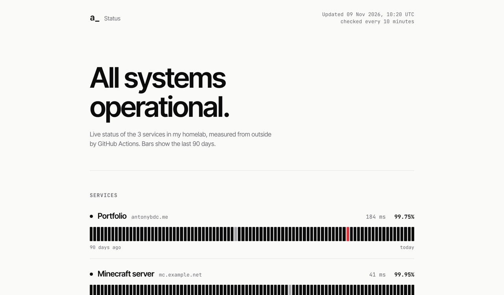
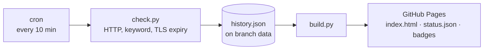

# antonybdc-status

A self-updating status page for my homelab, hosted for free on GitHub Pages.
GitHub Actions checks every service every 10 minutes from the outside, keeps 90 days of history
and publishes a static page, a JSON API and SVG badges. No server, no database, no dependencies.





## Features

- Uptime bars for 90 days per service (45 on phones). Hover or tap a day for uptime and average response time.
- Incidents open automatically when a check fails and close when it recovers, with duration.
- `status.json` for other tools, and a badge per service: ``
- Light and dark mode, self-hosted fonts, works without JavaScript (JS only adds the day readout and relative time).

## Add a service

```toml
# sites.toml
[[service]]
id = "grafana"
name = "Monitoring"
url = "https://grafana.example.net/api/health"
keyword = "ok"          # optional: must appear in the response
expect_status = 200     # optional
```

Push, and the next run picks it up. Removed services disappear from history as well.

## Setup

1. Fork or copy this repo.
2. *Settings → Pages → Source: GitHub Actions.*
3. Edit `sites.toml`, push. The first run creates the `data` branch.

Locally: `make test`, `make check`, `make serve`.

## Design decisions

- **History on its own branch.** Checks commit to `data`; `main` only contains code and config, so its log stays readable.
- **Daily aggregates instead of raw checks.** 90 days × 144 checks would be ~13,000 entries per service; storing counters per day keeps `history.json` a few kilobytes.
- **An outage is data, not a failed build.** The check script exits 0 when a site is down, otherwise every outage would also look like a broken workflow.
- **Measured from outside.** It complements [observatory](https://github.com/antony-bdc/observatory), which runs *inside* the network and can't notice when the whole network is unreachable.

Note: GitHub pauses scheduled workflows in repositories without activity for 60 days. The commits to the `data` branch count as activity.

---

Part of my homelab series → [observatory](https://github.com/antony-bdc/observatory) · [dwellers-galaxy](https://github.com/antony-bdc/dwellers-galaxy)
